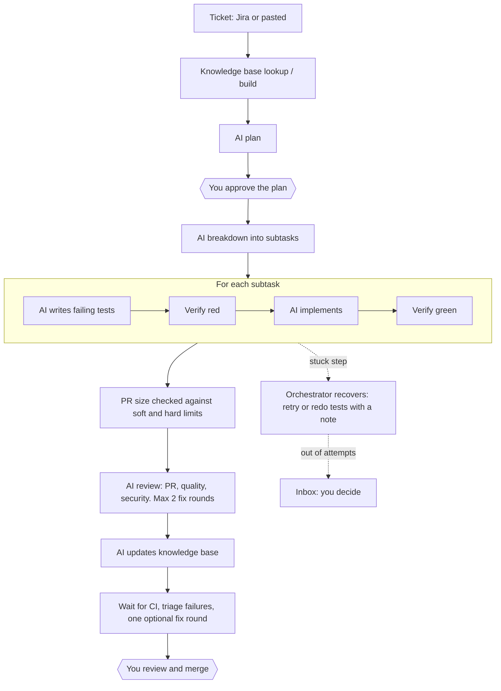

# sdlc-agent

[](https://github.com/pjx16/sdlc-agent/actions/workflows/ci.yml)
[](https://github.com/pjx16/sdlc-agent/releases)
[](./LICENSE)

A self-hosted, Docker-based **shipping engine** for solo developers. It turns tickets into reviewable pull requests with AI agents, while keeping AI usage lean and never giving agents access to your machine or credentials.

> [!NOTE]
> **Status: 1.0.** Releases follow [semantic versioning](https://semver.org/): a breaking change comes only in a new major version, with upgrade notes in the [CHANGELOG](https://github.com/pjx16/sdlc-agent/blob/dev/CHANGELOG.md), and `sdlc-agent upgrade` carries an install across it.
>
> **Known limits**
> - Only TypeScript/JavaScript stacks (Node.js, NestJS, Next.js) for now.
> - Single user, password login.
> - Agents run with full permissions inside their Docker containers. Don't point it at repositories you can't afford to lose, and don't run it on a machine that holds credentials you don't want exposed.
> - Spend budgets are checked between runs, so the run in progress when a budget is reached can go past it. Set a spend limit in the Anthropic Console as the hard stop.
>
> Feedback and bug reports are welcome: [open an issue](https://github.com/pjx16/sdlc-agent/issues).

**What has been tested.** The pipeline is implemented and covered by unit, integration and browser tests (a stand-in plays Claude in those). Two small real tickets have run end to end with live Claude, from a pasted ticket to a merged PR (see [`docs/LIVE_RUNS.md`](./docs/LIVE_RUNS.md)). Larger tickets, review findings, CI failures, Confluence and Jira have not been exercised live.

## What it does

sdlc-agent takes a ticket from Jira (or one pasted into its dashboard) and:

1. **Plans** it with AI (a solution design for a feature, a root-cause investigation for a bug; the plan lists the subtasks), posts it to Jira and commits it to the repository's knowledge-base folder, then waits for your approval.
2. **Breaks the approved plan down** into subtasks by itself.
3. **Implements each subtask test-first**, with AI agents running in isolated containers.
4. **Opens one pull request per ticket**, with one `test:` and one `feat:` commit per subtask, and keeps an eye on its size.
5. **Reviews** the result automatically (correctness against the acceptance criteria, code quality, and security when the diff touches risky code), with a capped number of fix rounds.
6. **Recovers from stuck steps by itself** where it can, and records every decision it takes.
7. **Hands you** a PR of "junior-engineer quality" to review, adjust and merge.

You stay in control at two points only: plan approval and merge. Anything else that needs you (a question only you can answer, a problem the pipeline could not fix in its attempts) appears in the inbox.

## Why

Turning tickets into reviewable PRs should take little hand-holding. This project aims to do that while:

- keeping AI usage efficient (one AI stage at a time, capped turns, small prompts, the right model per stage, and spend budgets that pause the pipeline), and
- never exposing your machine, GitHub credentials or Jira credentials to AI agents.

Anyone can clone the repository and run it with Docker Compose on macOS or a Linux VM.

## How it works



Key points:

- **One branch and one PR per ticket.** A draft PR opens after the first subtask and is marked ready after review and CI.
- **Scripted checks between stages:** dependency install, typecheck, targeted tests, a test-file tamper guard and a commit guard. The full test suite, lint and security scanners stay with your repository's CI.
- **Support queries:** an agent can ask you a question. The ticket goes on hold and the next ticket starts while you answer.
- **Self-recovery:** when a step gets stuck (for example a test that fails for the wrong reason), the orchestrator reads the failure and tries again with a note it writes, up to a limit you set (default 3), before it asks you. Every decision is stored, shown on the ticket's Decisions tab and commented on the Jira ticket. A push blocked by the pipeline's own earlier attempt is replaced under a lease; commits by anyone else never are.
- **Reviewable PRs:** the branch's changed lines are measured after every subtask against a soft (600) and a hard (1500) limit, both set per project. Crossing them is reported to Jira and, at the hard limit, on the PR with the size of each commit. Nothing is blocked.
- **Spend budgets:** the pipeline runs on an Anthropic API key and is billed per token. Set daily, weekly and monthly budgets in credits (1 credit = 1 USD of Anthropic credit balance), counted in your timezone. When one is used up the pipeline pauses until the next period starts, with *Resume* and *Ignore budgets until then* actions. A banner warns at 80% of a budget (configurable). The Usage page shows spend against each budget, the spend rate, a month-end projection and the average cost per ticket.
- **GitHub access, per project:** your own personal token (the default), or **sdlc-agent-bot**: you install the sdlc-agent GitHub App on the repository and everything is done in the bot's name with one-hour, single-repository tokens, so no personal token is needed. See [`docs/BOT.md`](./docs/BOT.md).
- **Knowledge base:** per-feature docs live in the target repository and are looked up through a deterministic index (a ticket is first mapped to a feature), then built or updated by AI stages.
- **Sixteen agents, one job each:** the prompts are markdown in [`guidelines/agents`](./guidelines/agents) and are also written to `.claude/agents/`. Eleven of them ship as a [Claude Code plugin](#use-the-agents-in-your-own-claude-code) you can use without the stack.
- **Onboarding and the inbox:** give a repository URL and the pipeline profiles it (stack, commands, Jira mapping) for you to accept; anything that needs you lands in the inbox, and you can rerun a ticket from any finished stage with a note.
- **Dashboard:** single-user password login, a live pipeline diagram that shows which step is moving, per-ticket overview (tokens, cost, time, PR size), inbox with the plan and breakdown to read before approving, live logs, settings, guideline editing and charts. Dates and chart axes use your own time zone.
- **Jira:** REST polling with a configurable JQL per project, issue-type routing, and ticket states mapped to Jira statuses. Plans are posted to Jira and committed to `<kb folder>/plans/<KEY>.md` in the repository. Pasting tickets works with or without Jira.

The integrations are described in [`docs/TRACKER.md`](./docs/TRACKER.md) For how the pieces fit together (services, trust boundaries, ticket lifecycle, worker loop, data model) and how that has changed over time, see [`docs/architecture`](./docs/architecture/README.md).

## Design principles

1. **Code does everything that needs no judgment.** Jira calls, git, GitHub, running tests, state tracking and scheduling are plain deterministic code. AI is used only for planning, breakdown, test writing, implementation, fixing, review, triage, choosing among legal moves and knowledge-base writing.
2. **Agents only edit files.** The orchestrator makes every commit, push, PR and Jira call. Agent containers never hold GitHub credentials, and never Jira credentials.
3. **Every AI stage is a fresh, narrow, capped run:** its own container, its own model, its own step limit, and only the context it needs.
4. **Humans gate two points:** plan approval and merge. Stuck steps are recovered by the orchestrator first, within a limit, and every decision is recorded.
5. **One AI stage runs at a time**, system-wide, to keep usage predictable.
6. **Everything is configurable per project** (stored in the database), with defaults shipped as files in the repository.

## Security model

This tool runs AI-generated code and holds a GitHub token. The short version; the full threat model and residual risks are in [`SECURITY.md`](./SECURITY.md).

- **Agents only edit files.** Agent containers run as a non-root user with all capabilities dropped, `no-new-privileges`, resource limits and a timeout, with no Docker socket, **no Anthropic API key** and no GitHub or Jira credentials (Jira connector mode's `jiraConnector` stage alone holds a claude.ai login, see [TRACKER.md](docs/TRACKER.md#credential-boundary)). The workspace's `.git` is mounted read-only.
- **Model calls go through an LLM gateway** inside the worker, which adds the Anthropic API key and forwards only `POST /v1/messages`, and only with the key it gave that run's container. **npm goes through a read-only mirror**, so an agent cannot publish. The egress proxy allows only Prisma's binary host. The worker reaches Docker through a **filtering `docker-proxy`** on a network of its own. It requires the agent image and the full sandbox on every container it starts, and it only touches containers carrying the agent label.
- The worker holds the GitHub and Jira credentials (in bot mode, one-hour single-repository tokens from the optional broker) and runs git with hooks, fsmonitor and credential helpers disabled. Repositories are restricted to `https://github.com/...`.
- The API is not published to the host, the dashboard binds to `127.0.0.1`, cross-site state-changing requests are refused, and secrets are redacted from logs and the dashboard.
- Tokens entered in the dashboard are encrypted in Postgres with `ENCRYPTION_KEY`; back up `.env` separately from the database.
- Ticket text and repository content are untrusted data. There is no auto-merge. Enable branch protection on every base branch.

Never publish the dashboard beyond `127.0.0.1` without a TLS reverse proxy and `COOKIE_SECURE=true`.

## Tech stack

| Piece | Choice |
| --- | --- |
| Runtime / language | Node.js 24 LTS, TypeScript (strict) |
| Repo layout | npm workspaces + Turborepo |
| API and worker | NestJS (two entrypoints in one codebase) |
| Dashboard | Next.js (App Router) + Tailwind CSS, Recharts |
| Database and queue | PostgreSQL 17 (no Redis), Prisma |
| Validation | Zod |
| Containers | Docker Compose, dockerode, a Docker socket proxy, Squid egress proxy, Verdaccio npm mirror |
| Agent | Claude Code CLI, headless (`claude -p`) |
| Git hosting | GitHub (HTTPS), `git` and `gh` CLI |
| Tests | Vitest, Testcontainers, Playwright |

Supported target stacks: TypeScript/Node, NestJS and Next.js.

## Architecture


The architecture is documented per version in [`docs/architecture`](./docs/architecture/README.md); the current one is [1.2.0](./docs/architecture/v1.2.0/README.md): the system and its containers, trust boundaries (which secret lives where), the ticket lifecycle, the subtask loop, recovery, the worker loop, stages and models, and the data model. **If you change the structure, add a new version folder in the same pull request** (the rules are in the index).

## Setup

Requirements:

- Docker (Engine 26 or newer, as in Docker Desktop 4.29 and later) and Docker Compose, on macOS or a Linux VM (the host user must be able to use the Docker socket)
- An Anthropic API key from the [Anthropic Console](https://console.anthropic.com/settings/keys), with credits. Set a spend limit on its workspace too
- A GitHub repository to ship into, and optionally a Jira Cloud project

### Install with the CLI

```bash
npx sdlc-agent init
```

`init` checks Docker, creates `~/.sdlc-agent` with generated secrets, starts the stack from the published images and opens the dashboard, where you enter the setup code it printed, create the admin password and add your tokens. Later: `sdlc-agent upgrade`, `down`, `up`, `logs`, `doctor`. See [`packages/cli`](./packages/cli/README.md).

### Install a release (tarball)

Releases are published on [GitHub Releases](https://github.com/pjx16/sdlc-agent/releases). Nothing is built on your machine: the images come from GHCR.

```bash
# Download sdlc-agent-<version>.tar.gz and SHA256SUMS from the release page, then:
shasum -a 256 -c --ignore-missing SHA256SUMS   # macOS; on Linux: sha256sum -c --ignore-missing SHA256SUMS
tar -xzf sdlc-agent-<version>.tar.gz
cd sdlc-agent-<version>
cp .env.example .env                   # set POSTGRES_PASSWORD and ENCRYPTION_KEY (openssl rand -base64 32); SDLC_VERSION is already set
printf 'SDLC_UID=%s\nSDLC_GID=%s\n' "$(id -u)" "$(id -g)" >> .env   # the daily backups in backups/ are written as you
docker compose --profile build build agent-image && docker compose up -d
```

`sdlc-agent up` builds the agent image inside Docker before starting the stack, so the first run takes a few minutes longer. The agent image is never published because it contains Claude Code, which is Anthropic's software (release installs build it from the release's git tag; a source checkout builds it with `npm run up:prod`). Repository code never lands on your disk: mirrors, workspaces and run logs live in the `sdlc_data` Docker volume, and only encrypted database backups are written to `backups/`. Docker Engine 26 or later is required. Then open `http://localhost:3000`, enter the setup code from `docker compose logs api | grep 'setup code'`, create the admin password, and add your tokens in the setup wizard. Then add a project.

The images on GHCR are signed. To verify one, use [cosign](https://docs.sigstore.dev/cosign/system_config/installation/) and the `cosign.pub` attached to every GitHub release:

```bash
cosign verify --key cosign.pub ghcr.io/pjx16/sdlc-agent-api:<version>
```

### Run from source

```bash
git clone https://github.com/pjx16/sdlc-agent.git
cd sdlc-agent
cp .env.example .env              # set POSTGRES_PASSWORD; ENCRYPTION_KEY is generated for you; tokens are entered in the dashboard
npm run up:prod                   # builds every image, including the agent image, and starts everything; waits until healthy
```

`npm run up:prod` is the supported way to start a source checkout: it creates `backups/`, clears old Docker build cache, builds the agent image (which a plain `docker compose up` does not: it sits behind the `build` profile) and waits for the health checks. Then open `http://localhost:3000`, enter the setup code from `docker compose logs api | grep 'setup code'`, add your tokens, and add a project. Mirrors, workspaces and logs live in the `sdlc_data` Docker volume. Development mode (`npm run up:dev`) runs the api and worker on your machine, so it uses a host folder, `DATA_DIR`, instead.

Who pushes and opens pull requests is chosen per project: your own personal token (the default) or **sdlc-agent-bot**, a GitHub App you install on the repository so that no token is needed. See [docs/BOT.md](./docs/BOT.md).

Other shortcuts, from the repository root:

```bash
npm run up:dev    # development mode: Docker project sdlc-agent-dev (Postgres on 5433, its own database) plus the proxy, the npm mirror and a relay that lets agents reach the worker's LLM gateway; API, worker and dashboard on your machine with hot reload (Ctrl+C stops them)
npm run down      # stops the production containers (project sdlc-agent)
npm run down:dev  # stops the development containers (project sdlc-agent-dev)
```

Development mode needs the GitHub CLI (`gh`) installed, because the worker runs outside Docker there.

Postgres is not published to the host in production or release installs; only the API and worker reach it on the private `internal` network. Development mode adds a loopback-only port (`127.0.0.1:5433`) through `docker-compose.dev.yml`. To open a SQL shell in production:

```bash
docker compose exec postgres psql -U sdlc sdlc
```

If you start with plain `docker compose up`, build the agent image first with `docker compose --profile build build agent-image`. If it is ever missing (for example after `docker image prune -a`), the dashboard's Activity card shows "Agent image" in red with this command, and tickets fail with the same instruction instead of a Docker error. If Docker runs out of disk space, `docker builder prune -af` frees the build cache without touching your database.

To stop: `docker compose down`. The database lives in a Docker volume and survives restarts.

## Use it as a desktop app

The dashboard can be installed as an app that opens in its own window, with its own icon and no browser tabs. The stack itself still runs in Docker.

- **Chrome or Edge:** click the install icon in the address bar, or the **Install app** button at the bottom of the sidebar.
- **Safari on macOS:** **File → Add to Dock**.
- It only works on `localhost` or `127.0.0.1` (or behind HTTPS), because browsers only offer installation on a secure context. Each address is a separate installed app.
- The stack must be running (`sdlc-agent up` or `docker compose up -d`) for the app window to show anything.
- Firefox cannot install it.

## Use the agents in your own Claude Code

Eleven of the agents also ship as a Claude Code plugin, `sdlc-subagents`, so you can call them from any session on any
machine, without running the stack: design, bug investigation, breakdown, tests, implementation, fixes, docs, the three
reviewers and CI triage. Agents that only make sense inside the pipeline (orchestrator, onboarding advisor, assistant,
feature mapper, repo profiler) are not in it.

```text
/plugin install sdlc-subagents --marketplace pjx16/sdlc-agent
```

On Claude Code before 2.1.275, run `/plugin marketplace add pjx16/sdlc-agent` then `/plugin install sdlc-subagents@sdlc-agent`.
The marketplace installs the plugin from the latest release's tag, not from `dev`, and its version is the release version. See [`plugins/sdlc-subagents/README.md`](./plugins/sdlc-subagents/README.md)
for the agents and how to use them.

## Adding a project

Open **Projects → New** and give a **repository URL** (an HTTPS `github.com` URL such as `https://github.com/acme/billing`) and, optionally, a Jira project key. The pipeline collects the facts (default branch and languages, Jira issue types, statuses and labels), asks the repo-profiler and onboarding-advisor agents for a proposal, and shows it for you to review and accept: stack and its install, typecheck and targeted-test commands (the test command must contain `{files}`), knowledge-base folder, Jira status mapping and approval status, issue-type routing, and intake label. Everything stays editable on the project page. Choose how the project reaches GitHub (your token or sdlc-agent-bot) and the **CLAUDE.md mode**: `ours` (our defaults; the repository's own `CLAUDE.md` is hidden from Claude), `theirs` (only the repository's) or `both`.

The worker then clones a bare mirror in the background. The project shows *Cloning*, then *Ready*, or *Failed* with the error (fix the URL or token and press Retry). A project accepts tickets only when it is *Ready*.

**Which Jira tickets are picked up.** By default only issues that carry the label **`sdlc-agent`**. With an empty JQL the query is `project = "KEY" AND labels = "sdlc-agent" ORDER BY created ASC`. A JQL you write is used exactly as written, so you can drop the label or filter on a status (for example `project = ABC AND issuetype in (Story, Bug, Task) AND status = "Ready for Dev" ORDER BY created ASC`). Jira sub-tasks are never picked up, and each issue becomes a ticket once. Pasting a ticket in the dashboard works in every Jira mode. Details: [`docs/TRACKER.md`](./docs/TRACKER.md).

Every per-project setting is listed in [`docs/CONFIGURATION.md`](./docs/CONFIGURATION.md#per-project-dashboard).

## Writing guidelines

What the agents are told lives in [`guidelines/`](./guidelines) as markdown, and is editable on the dashboard's **Guidelines** page:

- `agents/base/*.md`: what each of the 17 agents does (goal, steps, rules), with nothing about where it runs.
- `agents/pipeline/*.md`: what each agent gets and returns in the pipeline (inputs, the shape of the answer). A stage's prompt is its base plus this overlay. `npm run agents` regenerates `.claude/agents/` from both; a test fails when they drift.
- `agents/plugin/*.md` and `agents/plugin-preamble.md`: the same for the [`sdlc-subagents` plugin](#use-the-agents-in-your-own-claude-code), for the agents that ship in it (`plugin: true` in `packages/shared/src/agents.ts`). `npm run agents` regenerates `plugins/sdlc-subagents/` too. Dashboard edits change the pipeline only; the plugin changes with a release.
- `agents/shared-rules.md`: the rules every agent follows (scope, safety, small context, code standards, evidence, when to ask).
- `formats/*.md`: the ticket, plan, pull request description, review comments and Jira comments, with `{{placeholders}}`; `npm run formats` rewrites them from the defaults.
- `stacks/*.md`: conventions for each supported stack, added to every stage's system prompt.
- `default-CLAUDE.md`: how the pipeline runs and reports (headless, JSON only). With the shared rules it is our default `CLAUDE.md`, used in modes `ours` and `both`.
- `review-checklist.md` and `kb-doc-template.md`: what the review checks, and the shape of a knowledge-base doc.

Keep instructions short and concrete: every line is paid for in tokens on every run. Changes apply from the next stage run. The repository's own `CLAUDE.md` is the right place for rules that belong to that codebase.

## Configuration

Secrets and the few settings that must exist before the dashboard does live in `.env` (`.env.example` lists all of them with comments); everything else is entered in the dashboard. The essentials: `POSTGRES_PASSWORD`, `DATA_DIR` and `ENCRYPTION_KEY` (generated for you by `npm run up:prod` and the CLI). The full reference, token permissions and per-project settings are in [`docs/CONFIGURATION.md`](./docs/CONFIGURATION.md).

## Repository layout

```text
apps/
  api/            NestJS API and worker (Prisma, state machine, agent runner, LLM gateway, Git/GitHub/Jira clients)
  dashboard/      Next.js dashboard
  broker/         Optional token broker for sdlc-agent-bot (GitHub App); see docs/BOT.md
  e2e/            Playwright browser tests (own Postgres, built API, dashboard)
packages/
  shared/         Zod schemas, enums, state machine rules, the agent list
  cli/            The `sdlc-agent` installer and launcher (npm package)
docker/
  agent/          Agent image (Claude Code CLI, run-stage, run-cmd)
  worker/         Worker image (git, gh)
  proxy/          Squid egress proxy
  socket-proxy/   Filtering proxy in front of the Docker socket
  npm-mirror/     Read-only Verdaccio configuration
deploy/           Compose file shipped in release bundles
scripts/          up/down scripts, agent and format generators, version bump
plugins/
  sdlc-subagents/ Claude Code plugin with the general-purpose agents (generated by npm run agents)
docs/             Index, configuration, integrations, architecture per version, live runs, the project's own KB
guidelines/       Default CLAUDE.md, agent prompts, output formats, stack guidelines, review checklist
.claude/agents/   The 17 agents, generated from guidelines/agents
.claude-plugin/   Marketplace file listing the sdlc-subagents plugin
test/fake-claude/ Claude CLI stub used by tests
```

## Tests

```bash
npm test           # unit tests, no Docker needed
npm run test:int   # integration tests: Postgres through Testcontainers, real git, real Docker for the agent container tests
npm run test:e2e   # Playwright: a seeded Postgres, the built API and the dashboard, a real browser (first run: npx playwright install chromium)
npm run test:live  # needs LIVE_CLAUDE=1 and a real token: runs one stage against the real Claude Code CLI
```

The end-to-end suite starts its own Postgres container and the API and dashboard processes (it does not use the Compose stack, because the pages are checked against seeded states and the Compose stack would need a reachable GitHub repository). It logs in, creates a project, pastes a ticket, approves a plan and a breakdown, answers a support query, uses *Ignore usage* and *Resume*, opens every page, and checks every chart with data and without.

`test/fake-claude/` is a stand-in for the Claude CLI that plays scripted answers, so the whole pipeline can be tested without spending any usage.

## Scope and known limitations

Out of scope for now: Jira MCP mode (removed), a QA agent or post-merge testing, concurrency above 1, Jira webhooks or intake other than Jira and paste, git hosts other than GitHub (HTTPS only, no SSH URLs), multiple users or roles, stacks other than TS/Node, NestJS and Next.js, notifications, auto-merge, and cloud deployment scripts.

Known limitations:

- Targeted tests must be runnable inside a plain Node container with no external services (no database, no network beyond the npm registry).
- Spend is the cost Claude Code reports for each run. A run's cost counts when the run ends, so a budget can be overshot by the run that was in progress when it was reached.
- Only one stage runs at a time, system-wide, and a ticket's whole run is sequential.
- The first-pass rate on the Overview is approximate: a subtask has no completion time of its own, so it counts in the range where its last stage run ended.
- Only two small tickets have run with live Claude ([`docs/LIVE_RUNS.md`](./docs/LIVE_RUNS.md)). Review fixes, CI fixes, support queries, Jira and larger tickets have only been tested against the stand-in.
- A failed first dependency install leaves a half-installed `node_modules`, and Retry skips the reinstall. Delete the workspace's `node_modules` and reinstall, or delete the workspace (see [`docs/LIVE_RUNS.md`](./docs/LIVE_RUNS.md)).
- Creating a ticket through the API requires the text in `body`; unknown fields are rejected.

## Releases and versioning

Versions follow [semantic versioning](https://semver.org/). From 1.0.0, a breaking change (database, configuration, API) comes only in a new major version, with upgrade steps in [`CHANGELOG.md`](./CHANGELOG.md); `sdlc-agent upgrade` prints the notes between your version and the new one. Each release is a `vX.Y.Z` tag on `main`, which holds releases only, and also publishes the `sdlc-subagents` plugin at the same version. Releases are cut by a maintainer with `scripts/release.sh` (see [`CONTRIBUTING.md`](./CONTRIBUTING.md#cutting-a-release)). Release images are signed with the project's cosign key and carry an SBOM and BuildKit provenance; [`SECURITY.md`](./SECURITY.md#verifying-a-release) shows how to verify them. Third-party licences are listed in [`THIRD_PARTY_NOTICES.md`](./THIRD_PARTY_NOTICES.md).

## Contributing

Contributions are welcome: bug reports, documentation and pull requests (signed off under the [DCO](./CONTRIBUTING.md#developer-certificate-of-origin)). Start with [`CONTRIBUTING.md`](./CONTRIBUTING.md); questions go to [Discussions](https://github.com/pjx16/sdlc-agent/discussions) (see [`SUPPORT.md`](./SUPPORT.md)), and how decisions are made is in [`GOVERNANCE.md`](./GOVERNANCE.md).

## Security

Please do **not** report security vulnerabilities in public issues. Use GitHub's private vulnerability reporting (the repository's **Security** tab → **Report a vulnerability**). See [`SECURITY.md`](./SECURITY.md) for the threat model and the known residual risks.

This tool runs AI-generated code and holds a GitHub token. Review the [security model](#security-model), use a fine-grained token limited to the repositories you need, and enable branch protection.

## License

Released under the [MIT License](./LICENSE).

## Disclaimer

This is an independent project. It is not affiliated with, endorsed by or sponsored by Anthropic, Atlassian or GitHub. "Claude" and "Claude Code" are trademarks of Anthropic, "Jira" and "Atlassian" of Atlassian, and "GitHub" of GitHub, Inc. You are responsible for making sure your use of this tool complies with the terms of your Claude Code plan and of every service it connects to.
