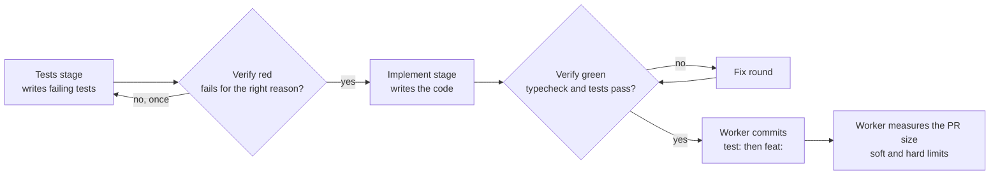
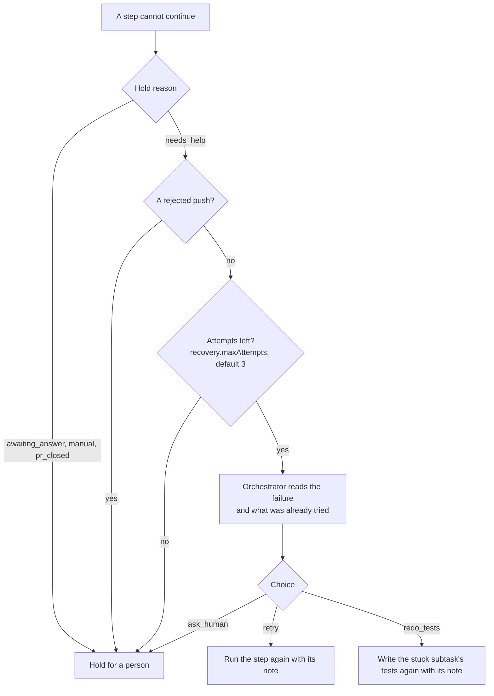
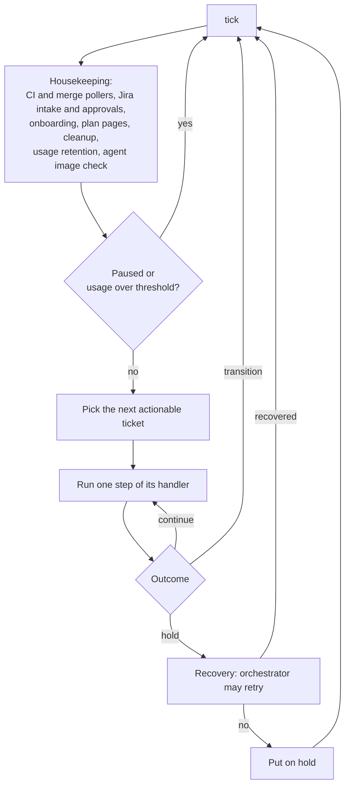
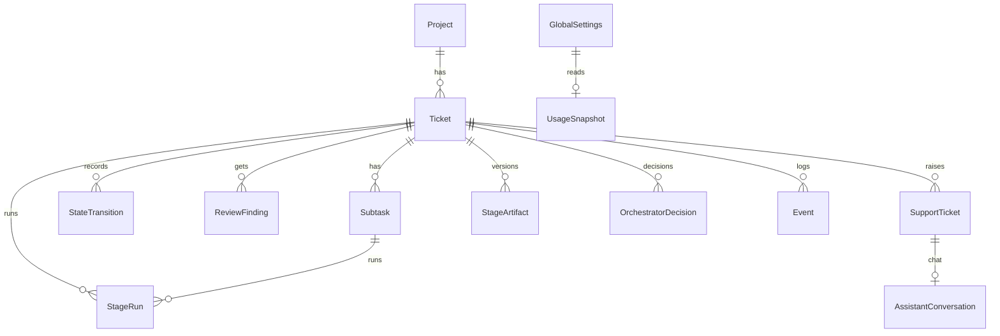

# Architecture, version 1.1.0

How sdlc-agent 1.1.0 is put together. This is a snapshot: later versions get their own folder (see the [index](../README.md)). This document describes what is built. What changed since 1.0.0 is in the [change log](../README.md#architecture-change-log) and summarised under [What changed in 1.1.0](#what-changed-in-110).

- Version: **1.1.0**
- Last reviewed: 2026-11-14
- Change log across versions: [`../README.md`](../README.md#architecture-change-log)
- The two main diagrams are hand-written SVG files in [`diagrams/`](./diagrams) (plain text, so changes show in a diff); the rest are [Mermaid](https://mermaid.js.org/), which GitHub renders. The SVGs follow the viewer's light or dark setting.

## Contents

- [What changed in 1.1.0](#what-changed-in-110)
- [The system in one picture](#the-system-in-one-picture)
- [Trust boundaries](#trust-boundaries)
- [Ticket lifecycle](#ticket-lifecycle)
- [Inside a subtask](#inside-a-subtask)
- [Recovering by itself](#recovering-by-itself)
- [The worker loop](#the-worker-loop)
- [Stages and models](#stages-and-models)
- [Data model](#data-model)
- [Code layout](#code-layout)
- [Design decisions](#design-decisions)

## What changed in 1.1.0

| Area | Before (1.0.0) | Now (1.1.0) |
| --- | --- | --- |
| Human gates | Plan, breakdown, merge | **Plan and merge.** The plan lists the subtasks; the breakdown runs by itself |
| Stuck steps | A stage that failed twice put the ticket on hold for a person | The orchestrator tries to recover first (retry or redo tests with a note, 3 attempts), then asks a person |
| GitHub access | One personal token, held by the worker | **Per project:** the personal token, or the sdlc-agent GitHub App as `sdlc-agent[bot]` through an optional **token broker** (one-hour, single-repository tokens) |
| Pushes | Never forced | Never forced, except to replace the pipeline's own superseded commits under a lease |
| Usage | Paused on Claude's warning and on the thresholds | Pauses only on the thresholds or a rejection; a warning shows a banner |
| Pull request size | Not measured | Measured after every subtask against soft and hard limits; reported, never blocking |
| CI failures | The fixer got the last failed workflow log | The fixer gets a report of every failing check (CodeQL results, annotations, logs) |
| Housekeeping | CI, merge, cleanup, Jira | Also: onboarding, plan pages, orphan cleanup, usage retention, agent-image check |

## The system in one picture


Source: [`diagrams/system.svg`](./diagrams/system.svg). Amber boxes are people, teal are AI work, red are containers that hold no GitHub or Jira key. The token broker is optional and runs outside the Compose network, operated by the owner of the GitHub App.

| Part | Does | Does not |
| --- | --- | --- |
| Dashboard | Login, queue, pipeline diagram, approvals, inbox, ticket overview, settings, guidelines, charts | Talk to the database or any outside service |
| API | REST for the dashboard; reads and writes tickets, approvals, settings; connects this system to the broker (`/bot`) | Run stages |
| Worker | The only place that runs stages, git, GitHub and Jira calls, polling, recovery and housekeeping | Run repository code itself |
| Agent container | Edits files in one workspace for one stage, then exits | Hold GitHub or Jira credentials, commit, or push |
| Command container | Runs install, typecheck and targeted tests | Hold the Claude token or any other credential |
| Proxy | Allows the Anthropic API, the npm registry and Prisma's binary host (port 3128) | Anything else |
| Token broker (optional) | Holds the GitHub App's private key; hands a connected system a one-hour token for one repository | Hold any repository content, or give a system a token for another system's installation |

The API and the worker are separate Compose services built from one codebase (`apps/api`). Only the worker mounts the Docker socket. The broker is a separate small service (`apps/broker`) with its own image; see [`docs/BOT.md`](../../BOT.md).

## Trust boundaries

Ticket text and repository content are untrusted. Each secret lives in exactly one place:

| Secret | Held by | Reaches agent containers? |
| --- | --- | --- |
| Claude token | Worker, passed to agent containers only | Yes, this is the only one |
| GitHub personal token (projects that use it) | Worker (`git` through an askpass helper, `gh`) | No |
| Broker key (projects that work as the bot) | Worker and API, encrypted in Postgres; it can only ask for tokens for installations this system connected | No |
| GitHub App private key | The token broker only | No |
| Installation token (one hour, one repository) | Worker memory, handed to `git` and `gh` per call | No |
| Jira credentials | Worker (REST) | No |
| Dashboard password, session secret | API | No |

The worker picks the token **per call**: the repository comes from the call's URL, `-R` flag, `repos/` path or the project folder, and a project that works as the bot gets a broker token (cached until five minutes before it expires) while every other project uses the personal token. A system connected to the broker is not blocked for lack of a personal token.

The broker proves an installation belongs to a system with the installer's own GitHub login (OAuth during the App installation), so a forged callback cannot claim someone else's installation. It stores only a hash of each system's key, keeps its records in maps (never in objects keyed by request data), and limits registrations per address.

Agent containers run as a non-root user with all capabilities dropped, `no-new-privileges`, memory, CPU and pid limits, a wall-clock timeout and no Docker socket. Their only network path is the proxy. The worker commits with git hooks disabled (`core.hooksPath=/dev/null`) and `core.fsmonitor=false`, so a workspace's own git config cannot run code in the worker. Logs and API output pass through a redactor, and command output has its terminal colour codes removed.

## Ticket lifecycle


Source: [`diagrams/lifecycle.svg`](./diagrams/lifecycle.svg). The exact states and transitions are in `packages/shared/src/state-machine.ts`:

```text
NEW → KB → PLANNING → AWAITING_PLAN_APPROVAL → BREAKDOWN
  → IN_PROGRESS → REVIEW → KB_UPDATE → AWAITING_CI → IN_HUMAN_REVIEW → DONE
A rejected plan goes back to PLANNING. ON_HOLD and FAILED return to where they were.
```

`AWAITING_BREAKDOWN_APPROVAL` still exists in the state table so that a ticket that was waiting at that gate when it was removed can be approved; no new ticket enters it. The breakdown gate setting is ignored (forced off) for every project.

Any working state can move to `ON_HOLD`. Resume, and Retry for a `FAILED` ticket, return it to the state it was in (`holdFromStatus`). Hold reasons: `awaiting_answer` (the agent asked a question), `needs_help` (a step is stuck and the orchestrator's recovery attempts are used up or not applicable), `loop_limit` (a per-ticket limit such as the CI fix rounds was reached), `manual` (you paused or killed it), `pr_closed`. The plan gate, review rounds, CI fix rounds, recovery attempts and PR size limits are per-project settings. The usage gate pauses the whole pipeline, not one ticket.

Every transition is a row in `StateTransition`, written by one state machine (`apps/api/src/state`). Nothing else changes a ticket's status.

## Inside a subtask



Between stages the worker, not the agent, runs install, typecheck and the targeted tests, checks that test files were not edited during implement (tamper guard), and checks which files changed (commit guard). After each completed subtask the branch's changed lines (added plus deleted, without lockfiles and generated files) are measured against `limits.prSoftLines` (600) and `limits.prHardLines` (1500): crossing a limit is recorded as a decision, written to Jira, and at the hard limit also posted on the PR with the size of each commit. It never blocks. While a command runs the dashboard says what the worker is doing (installing, typechecking, running tests).

## Recovering by itself



- **Where:** `RecoveryService` runs in the worker loop when a step returns a `needs_help` hold. The orchestrator is the `orchestrate` stage at the decision point `recovery`; its `note` becomes the stuck subtask's `lastFailure`, which the next tests, implement or fix run receives.
- **Every decision is recorded:** an `OrchestratorDecision` row (point, options, choice, reason and the instruction given), an event, and a comment on the Jira ticket. The ticket's Decisions tab shows them.
- **Not given to the orchestrator:** questions, manual pauses, closed PRs and rejected pushes (no note can change them).
- **Push recovery is code, not AI.** A non-fast-forward push is retried with `--force-with-lease` pinned to the remote commit that was inspected, only when every commit that only the remote has was made by the pipeline's own identity (an earlier attempt that a rerun replaced). Commits by anyone else are never replaced, and the replacement is recorded as a decision and written to Jira. An open PR that an earlier attempt left on the branch is adopted instead of opened again.
- **CI failures:** the fixer receives a report of every failing check (workflow logs, a check such as CodeQL with its summary, annotations and the open code-scanning alerts of the PR), and a ticket that used its CI fix rounds (`loopLimits.ciFix`) goes on hold with `loop_limit`.

## The worker loop



- A Postgres advisory lock allows one worker, and the loop runs one stage at a time system-wide.
- Handlers: new ticket (workspace and install), knowledge base, plan, breakdown, subtask loop, `ReviewHandler`, `KbUpdateHandler`, `CiFixHandler`, `HumanReviewHandler` (KB re-run on request).
- After every stage the usage gate reads Claude Code's rate-limit event and pauses the pipeline when a window crosses the threshold set in Settings (default 50% for 5 hours, 80% for the week) or when Claude rejects a request. Claude's own `allowed_warning` never pauses; the dashboard shows a banner.
- Pollers: CI status every 30 s, PR merge detection, Jira intake and approvals (REST per project).
- The worker's status row carries what it is doing (including installs and test runs) and whether the agent image is present (`agentImageError`), checked every minute; the dashboard turns both into plain words.

## Stages and models

Defaults; all are per-project settings.

| Stage | Model | Produces |
| --- | --- | --- |
| `kbBuild` | Sonnet | A knowledge-base doc for the feature area |
| `featureMap` | Haiku | Which knowledge-base feature a ticket belongs to |
| `solutionDesign` (features), `bugInvestigation` (bugs) | Opus | The plan, including the subtasks, for your approval |
| `technicalDesign` | Sonnet | Ordered subtasks with acceptance criteria and dependencies, from the approved plan |
| `tests`, `implement`, `fix` | Sonnet | Failing tests, then the code, then fixes, per subtask |
| `prReview`, `securityReview` | Sonnet | Findings per round, each with file, rule and fix |
| `qualityReview` | Haiku | Readability and standards findings |
| `kbUpdate` | Sonnet | The same doc, corrected to match what was built |
| `ciTriage` | Haiku | Whether a CI failure is code, flaky or infrastructure |
| `orchestrate` | Haiku | A choice among legal moves, and recovery decisions with a note |
| `assist` | Sonnet | Drafts for one inbox item (answers, plan edits, notes to copy) |
| `repoProfile`, `onboardAdvise` | Sonnet, Haiku | Project onboarding: commands, and the Jira mapping |

Stage instructions are markdown files in [`guidelines/stages`](../../../guidelines/stages), turned into `.claude/agents` files by `npm run agents`. Each stage is a fresh container with its own model, turn limit and only the context it needs.

## Data model



`Project` holds settings as JSON validated by the schemas in `packages/shared`, plus `githubAuth` (`token` or `bot`). `Ticket` records the branch size (`prDiffLines`, `prSizeLevel`). `GlobalSettings` holds the pause flag, usage thresholds and calibration. `StageRun` records model, tokens (including cache), turns, cost and log path for every run. `OrchestratorDecision` holds every choice the orchestrator made (points include `recovery`, `pr_size` and `push_replace`). `WorkerStatus` holds the heartbeat, the phase and `agentImageError`. `Credential` holds the encrypted tokens, including the broker key. `Session` backs the dashboard login. The Prisma schema is `apps/api/prisma/schema.prisma`.

## Code layout

| Path | Contents |
| --- | --- |
| `apps/api` | NestJS: REST API, worker, state machine, agent runner, git, GitHub and Jira clients, orchestrator and recovery, broker client and `/bot`, metrics |
| `apps/broker` | The token broker: a small HTTP service with no runtime dependencies |
| `apps/dashboard` | Next.js App Router dashboard |
| `apps/e2e` | Playwright suite (own Postgres, built API, dashboard) |
| `packages/shared` | Zod schemas, enums, state machine rules, stage envelope, error policy |
| `docker/agent`, `docker/worker`, `docker/proxy` | The three images (the broker has its own Dockerfile) |
| `guidelines` | Default `CLAUDE.md`, stage prompts, formats, stack guidelines, review checklist |
| `docs/BOT.md` | Working as sdlc-agent-bot, and running the broker |
| `test/fake-claude` | Claude CLI stand-in used by tests |

## Design decisions

1. **Code does what needs no judgment.** Git, GitHub, Jira, test runs, state and scheduling are deterministic code. AI plans, writes tests and code, reviews, writes docs, and chooses among legal moves.
2. **Agents only edit files.** The worker makes every commit, push, PR and Jira call.
3. **One AI stage at a time, system-wide.** Keeps usage predictable and makes the usage gate simple.
4. **Postgres is the queue.** No Redis; the advisory lock and status columns are enough for one worker.
5. **Humans gate two points: plan and merge.** The plan carries the subtasks, so there is no second approval. There is no auto-merge.
6. **Stuck steps recover before a person is asked.** A bounded number of attempts, each a recorded, Jira-visible decision; a person is asked when the budget is used up or no instruction could help.
7. **Reviewable pull requests are measured, not enforced.** Size limits report and explain; they never block.
8. **Two ways to reach GitHub, chosen per project.** A personal token, or a GitHub App through a broker, so a user can work without a personal token and no secret that spans users is ever shipped.
9. **Pushes are never forced, with one narrow exception:** replacing the pipeline's own superseded commits under a lease.
10. **The KB lives in the target repository** and is indexed deterministically, so a stage reads one small doc instead of the codebase.
11. **Strict input at the edge.** Request bodies are validated with Zod; ticket creation rejects unknown fields; the broker validates the shape of every key and state before it looks anything up.

## Changing this document

This folder describes 1.1.0 and should stay true to it. Fix errors here. For a change that alters the architecture, follow [how versions work](../README.md#how-versions-work) and start a new version folder.
